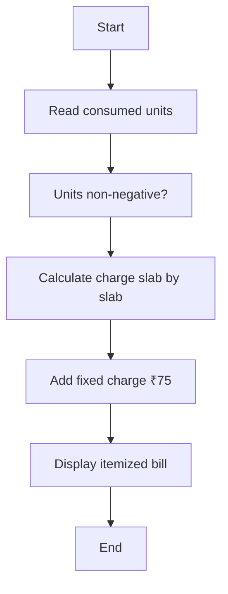

# Case Study 02: Progressive Electricity Billing

## 1. Problem Statement
Calculate a household electricity bill using progressive consumption slabs, where units in each slab are charged at that slab's rate.

## 2. Objectives
- Implement tiered billing correctly
- Use loops to process slabs
- Validate units and fixed charges
- Display energy charge and final bill

## 3. Assumptions
- 0–100 units: ₹1.50/unit; 101–200: ₹2.50/unit; above 200: ₹4.00/unit.
- A fixed charge of ₹75 is added to every bill.
- Units and fixed charge must be non-negative.

## 4. Algorithm
1. Validate units and fixed charge.
2. Process each slab in order.
3. Charge only the units that fall within that slab.
4. Add the fixed charge.
5. Return the itemized total.

## 5. Flowchart


## 6. Pseudocode
```text
FUNCTION calculate_bill(units, fixed_charge=75)\n  VALIDATE units >= 0 AND fixed_charge >= 0\n  energy = 0\n  FOR each slab (limit, rate):\n    charge units within slab at rate\n  total = energy + fixed_charge\n  RETURN energy, fixed_charge, total\nEND
```

## 7. Python Source Code
See [`../programs/electricity_billing.py`](../programs/electricity_billing.py).

## 8. Test Cases with Solutions
| Test | Input / scenario | Expected solution |
|---|---|---|
| 1. Zero units | 0 units | Energy ₹0.00; total ₹75.00 |
| 2. First slab boundary | 100 units | Energy ₹150.00; total ₹225.00 |
| 3. Two slabs | 150 units | Energy ₹275.00; total ₹350.00 |
| 4. Above 200 units | 250 units | Energy ₹600.00; total ₹675.00 |

## 9. Execution Output
Screenshot: `../screenshots/case_02_output.png`.

```text
PROGRESSIVE ELECTRICITY BILLING
0 units: energy=₹0.00, fixed=₹75.00, total=₹75.00
100 units: energy=₹150.00, fixed=₹75.00, total=₹225.00
150 units: energy=₹275.00, fixed=₹75.00, total=₹350.00
250 units: energy=₹600.00, fixed=₹75.00, total=₹675.00
```

## 10. Test Execution
Automated test file: [`../tests/test_case_02.py`](../tests/test_case_02.py).

```text
test_01_primary (rerun_test_case_02.TestCase02.test_01_primary) ... ok
test_02_boundary (rerun_test_case_02.TestCase02.test_02_boundary) ... ok
test_03_alternate (rerun_test_case_02.TestCase02.test_03_alternate) ... ok
test_04_edge (rerun_test_case_02.TestCase02.test_04_edge) ... ok

----------------------------------------------------------------------
Ran 4 tests in 0.000s

OK

```

## 11. Conclusion
The program implements the specified rules and was checked against the listed test scenarios. Thresholds and rates are illustrative academic assumptions and should be replaced with official requirements if provided by faculty.
