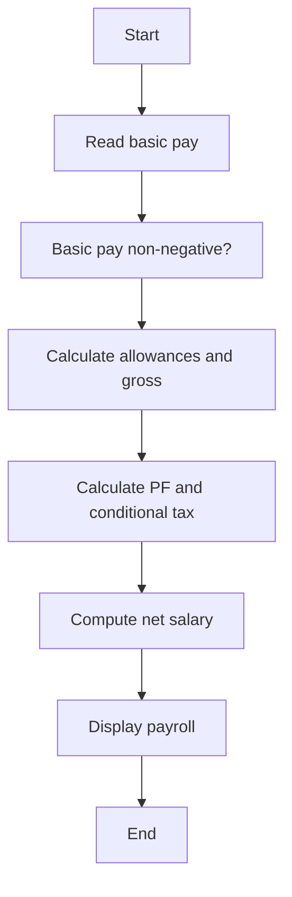

# Case Study 03: Employee Payroll and Deduction Analysis

## 1. Problem Statement
Compute an employee's gross salary, provident-fund deduction, income-tax deduction, and net salary from basic pay and allowances.

## 2. Objectives
- Calculate gross pay from multiple components
- Apply percentage deductions
- Produce a transparent salary breakdown
- Prevent invalid negative salary inputs

## 3. Assumptions
- HRA is 20% of basic pay; other allowance is 10%.
- PF is 12% of basic pay.
- Illustrative income tax is 5% of gross pay when gross exceeds ₹50,000; otherwise zero.
- These are assignment rules, not tax or payroll advice.

## 4. Algorithm
1. Validate basic pay.
2. Calculate HRA and other allowance.
3. Compute gross salary.
4. Calculate PF and conditional tax.
5. Subtract deductions from gross pay.
6. Return a rounded payroll statement.

## 5. Flowchart


## 6. Pseudocode
```text
FUNCTION payroll(basic)\n  VALIDATE basic >= 0\n  hra = basic * 0.20; allowance = basic * 0.10\n  gross = basic + hra + allowance\n  pf = basic * 0.12\n  tax = gross * 0.05 IF gross > 50000 ELSE 0\n  net = gross - pf - tax\n  RETURN breakdown\nEND
```

## 7. Python Source Code
See [`../programs/employee_payroll.py`](../programs/employee_payroll.py).

## 8. Test Cases with Solutions
| Test | Input / scenario | Expected solution |
|---|---|---|
| 1. Below tax threshold | Basic ₹20,000 | Gross ₹26,000; PF ₹2,400; tax ₹0; net ₹23,600 |
| 2. Boundary gross ₹50,000 | Basic ₹38,461.53 (gross just below ₹50,000) | Tax is zero at gross <= ₹50,000 |
| 3. Tax applies | Basic ₹60,000 | Gross ₹78,000; PF ₹7,200; tax ₹3,900; net ₹66,900 |
| 4. Zero basic | Basic ₹0 | All amounts ₹0.00 |

## 9. Execution Output
Screenshot: `../screenshots/case_03_output.png`.

```text
EMPLOYEE PAYROLL AND DEDUCTION ANALYSIS
Basic ₹20000.00: gross=₹26000.00, PF=₹2400.00, tax=₹0.00, net=₹23600.00
Basic ₹40000.00: gross=₹52000.00, PF=₹4800.00, tax=₹2600.00, net=₹44600.00
Basic ₹60000.00: gross=₹78000.00, PF=₹7200.00, tax=₹3900.00, net=₹66900.00
```

## 10. Test Execution
Automated test file: [`../tests/test_case_03.py`](../tests/test_case_03.py).

```text
test_01_primary (rerun_test_case_03.TestCase03.test_01_primary) ... ok
test_02_boundary (rerun_test_case_03.TestCase03.test_02_boundary) ... ok
test_03_alternate (rerun_test_case_03.TestCase03.test_03_alternate) ... ok
test_04_edge (rerun_test_case_03.TestCase03.test_04_edge) ... ok

----------------------------------------------------------------------
Ran 4 tests in 0.000s

OK

```

## 11. Conclusion
The program implements the specified rules and was checked against the listed test scenarios. Thresholds and rates are illustrative academic assumptions and should be replaced with official requirements if provided by faculty.
