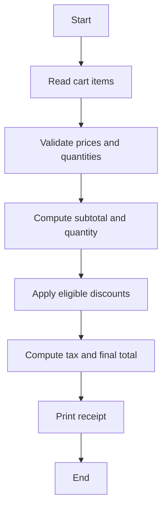

# Case Study 04: Retail Billing with Multiple Discount Rules

## 1. Problem Statement
Create a retail checkout calculator that applies a customer discount and an additional bulk discount, then computes tax on the discounted subtotal.

## 2. Objectives
- Process a cart with multiple items
- Apply ordered discount rules
- Calculate tax after discounts
- Return an itemized receipt

## 3. Assumptions
- Each item is a (name, unit_price, quantity) tuple.
- A 10% loyalty discount applies when subtotal is at least ₹2,000.
- A 5% bulk discount applies when total quantity is at least 10.
- Discounts are sequential percentages on the original subtotal; tax is 5% after discounts.

## 4. Algorithm
1. Validate each item and calculate subtotal and quantity.
2. Apply loyalty discount if threshold is met.
3. Apply bulk discount if quantity threshold is met.
4. Calculate 5% tax on the discounted amount.
5. Return receipt totals.

## 5. Flowchart


## 6. Pseudocode
```text
FUNCTION checkout(items)\n  VALIDATE prices >= 0 and quantities >= 0\n  subtotal = SUM(price * quantity)\n  loyalty = 10% subtotal IF subtotal >= 2000 ELSE 0\n  bulk = 5% subtotal IF total_quantity >= 10 ELSE 0\n  discounted = subtotal - loyalty - bulk\n  tax = discounted * 0.05\n  RETURN receipt\nEND
```

## 7. Python Source Code
See [`../programs/retail_billing.py`](../programs/retail_billing.py).

## 8. Test Cases with Solutions
| Test | Input / scenario | Expected solution |
|---|---|---|
| 1. No discount | 2 pens at ₹20 | Subtotal ₹40; total ₹42.00 |
| 2. Loyalty only | 2 bags at ₹1,200 | Subtotal ₹2,400; loyalty ₹240; total ₹2,268.00 |
| 3. Bulk only | 10 notebooks at ₹100 | Bulk ₹50; total ₹997.50 |
| 4. Both discounts | 10 headsets at ₹250 | Subtotal ₹2,500; discounts ₹375; total ₹2,231.25 |

## 9. Execution Output
Screenshot: `../screenshots/case_04_output.png`.

```text
RETAIL BILLING WITH MULTIPLE DISCOUNT RULES
Small cart: subtotal=₹40.00, discounts=₹0.00, tax=₹2.00, total=₹42.00
Loyalty discount: subtotal=₹2400.00, discounts=₹240.00, tax=₹108.00, total=₹2268.00
Bulk discount: subtotal=₹1000.00, discounts=₹50.00, tax=₹47.50, total=₹997.50
Both discounts: subtotal=₹2500.00, discounts=₹375.00, tax=₹106.25, total=₹2231.25
```

## 10. Test Execution
Automated test file: [`../tests/test_case_04.py`](../tests/test_case_04.py).

```text
test_01_primary (rerun_test_case_04.TestCase04.test_01_primary) ... ok
test_02_boundary (rerun_test_case_04.TestCase04.test_02_boundary) ... ok
test_03_alternate (rerun_test_case_04.TestCase04.test_03_alternate) ... ok
test_04_edge (rerun_test_case_04.TestCase04.test_04_edge) ... ok

----------------------------------------------------------------------
Ran 4 tests in 0.000s

OK

```

## 11. Conclusion
The program implements the specified rules and was checked against the listed test scenarios. Thresholds and rates are illustrative academic assumptions and should be replaced with official requirements if provided by faculty.
