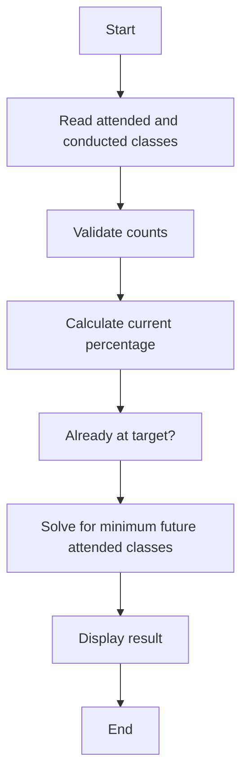

# Case Study 05: Attendance Recovery Computation

## 1. Problem Statement
Calculate current attendance percentage and determine the minimum consecutive classes a student must attend to reach a required attendance percentage.

## 2. Objectives
- Calculate attendance percentages
- Solve a threshold inequality
- Handle already-eligible and impossible cases
- Explain the result clearly

## 3. Assumptions
- Attendance policy threshold is 75%.
- Attended classes cannot exceed conducted classes.
- Future classes are assumed to be attended without absence.
- If no classes have been conducted, current percentage is reported as 0%.

## 4. Algorithm
1. Validate attended and conducted counts.
2. Calculate current percentage.
3. If percentage already meets the threshold, required classes are zero.
4. Otherwise solve (attended+x)/(conducted+x) >= threshold.
5. Round the required number of classes up to the next integer.

## 5. Flowchart


## 6. Pseudocode
```text
FUNCTION recovery(attended, conducted, target=0.75)\n  VALIDATE counts and attended <= conducted\n  IF conducted = 0: current = 0 ELSE current = attended/conducted\n  IF current >= target: return 0 classes\n  required = CEILING((target*conducted-attended)/(1-target))\n  RETURN current, required\nEND
```

## 7. Python Source Code
See [`../programs/attendance_recovery.py`](../programs/attendance_recovery.py).

## 8. Test Cases with Solutions
| Test | Input / scenario | Expected solution |
|---|---|---|
| 1. Below target | 18 attended / 30 conducted | 60%; attend next 18 classes to reach 75% |
| 2. Already eligible | 20/25 | 80%; 0 additional classes |
| 3. No classes yet | 0/0 | 0%; 0 additional classes under current formula (first attended classes can be counted) |
| 4. Exactly target | 35/50 | 70%; attend next 10 classes to reach 75% |

## 9. Execution Output
Screenshot: `../screenshots/case_05_output.png`.

```text
ATTENDANCE RECOVERY COMPUTATION
18/30: current=60.00%, target=75%, required future classes=18
20/25: current=80.00%, target=75%, required future classes=0
0/0: current=0.00%, target=75%, required future classes=0
35/50: current=70.00%, target=75%, required future classes=10
```

## 10. Test Execution
Automated test file: [`../tests/test_case_05.py`](../tests/test_case_05.py).

```text
test_01_primary (rerun_test_case_05.TestCase05.test_01_primary) ... ok
test_02_boundary (rerun_test_case_05.TestCase05.test_02_boundary) ... ok
test_03_alternate (rerun_test_case_05.TestCase05.test_03_alternate) ... ok
test_04_edge (rerun_test_case_05.TestCase05.test_04_edge) ... ok

----------------------------------------------------------------------
Ran 4 tests in 0.000s

OK

```

## 11. Conclusion
The program implements the specified rules and was checked against the listed test scenarios. Thresholds and rates are illustrative academic assumptions and should be replaced with official requirements if provided by faculty.
