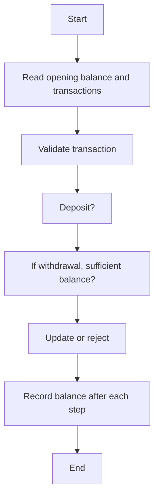

# Case Study 06: ATM Transaction Sequence Simulation

## 1. Problem Statement
Simulate a sequence of ATM withdrawals and deposits while maintaining balance, rejecting invalid transactions, and preventing overdrafts.

## 2. Objectives
- Maintain account state
- Validate transaction sequences
- Handle insufficient funds
- Record transaction outcomes

## 3. Assumptions
- Opening balance cannot be negative.
- Withdrawals and deposits must be positive amounts.
- A withdrawal is rejected if it exceeds the current balance.
- Invalid transactions do not change the balance.

## 4. Algorithm
1. Validate opening balance.
2. Process transactions in sequence.
3. For each transaction, validate type and amount.
4. Apply deposit or approve/reject withdrawal.
5. Record status and resulting balance.

## 5. Flowchart


## 6. Pseudocode
```text
FUNCTION simulate(balance, transactions)\n  VALIDATE balance >= 0\n  FOR (type, amount) IN transactions:\n    IF amount <= 0: reject\n    ELSE IF deposit: balance += amount\n    ELSE IF withdrawal and amount <= balance: balance -= amount\n    ELSE reject\n    RECORD status and balance\n  RETURN ledger, balance\nEND
```

## 7. Python Source Code
See [`../programs/atm_simulation.py`](../programs/atm_simulation.py).

## 8. Test Cases with Solutions
| Test | Input / scenario | Expected solution |
|---|---|---|
| 1. Successful withdrawal | Opening ₹1,000; withdraw ₹300 | Approved; balance ₹700 |
| 2. Deposit then withdrawal | Opening ₹1,000; deposit ₹500; withdraw ₹1,200 | Final balance ₹300 |
| 3. Insufficient funds | Opening ₹1,000; withdraw ₹1,500 | Rejected; balance remains ₹1,000 |
| 4. Invalid zero amount | Opening ₹1,000; deposit ₹0 | Rejected; balance remains ₹1,000 |

## 9. Execution Output
Screenshot: `../screenshots/case_06_output.png`.

```text
ATM TRANSACTION SEQUENCE SIMULATION
1. withdraw ₹300.00: APPROVED | balance ₹700.00
2. deposit ₹500.00: APPROVED | balance ₹1200.00
3. withdraw ₹1500.00: REJECTED: insufficient funds | balance ₹1200.00
4. deposit ₹0.00: REJECTED: amount must be positive | balance ₹1200.00
5. withdraw ₹200.00: APPROVED | balance ₹1000.00
Final balance: ₹1000.00
```

## 10. Test Execution
Automated test file: [`../tests/test_case_06.py`](../tests/test_case_06.py).

```text
test_01_primary (rerun_test_case_06.TestCase06.test_01_primary) ... ok
test_02_boundary (rerun_test_case_06.TestCase06.test_02_boundary) ... ok
test_03_alternate (rerun_test_case_06.TestCase06.test_03_alternate) ... ok
test_04_edge (rerun_test_case_06.TestCase06.test_04_edge) ... ok

----------------------------------------------------------------------
Ran 4 tests in 0.000s

OK

```

## 11. Conclusion
The program implements the specified rules and was checked against the listed test scenarios. Thresholds and rates are illustrative academic assumptions and should be replaced with official requirements if provided by faculty.
