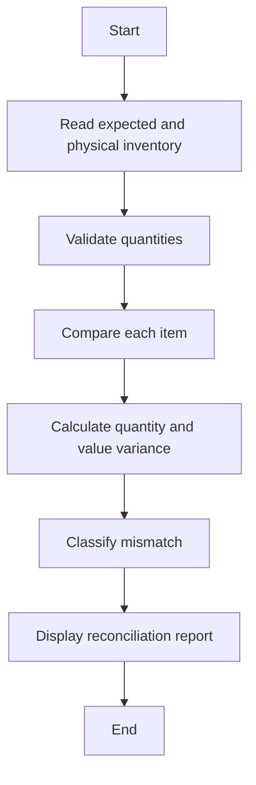

# Case Study 07: Warehouse Inventory Reconciliation

## 1. Problem Statement
Compare expected stock with physical stock counts and report shortages, overages, and matched items.

## 2. Objectives
- Represent stock with dictionaries
- Compare expected and counted quantities
- Classify discrepancies
- Calculate inventory value variance

## 3. Assumptions
- Inventory quantities are non-negative integers.
- Unit cost is non-negative.
- Variance is physical count minus expected stock.
- A negative variance means shortage; positive means overage.

## 4. Algorithm
1. Validate expected stock and physical count.
2. Iterate over the union of item names.
3. Calculate quantity variance.
4. Classify as MATCHED, SHORTAGE, or OVERAGE.
5. Calculate variance value using unit cost when provided.

## 5. Flowchart


## 6. Pseudocode
```text
FUNCTION reconcile(expected, physical, costs)\n  items = UNION(keys(expected), keys(physical))\n  FOR each item:\n    variance = physical.get(item,0) - expected.get(item,0)\n    classify variance as shortage/overage/matched\n    value_variance = variance * costs.get(item,0)\n  RETURN report\nEND
```

## 7. Python Source Code
See [`../programs/inventory_reconciliation.py`](../programs/inventory_reconciliation.py).

## 8. Test Cases with Solutions
| Test | Input / scenario | Expected solution |
|---|---|---|
| 1. Shortage | Expected 10, physical 9, cost ₹100 | Variance -1; SHORTAGE; value variance -₹100 |
| 2. Overage | Expected 5, physical 8, cost ₹20 | Variance +3; OVERAGE; value variance ₹60 |
| 3. Matched | Expected 4, physical 4 | Variance 0; MATCHED |
| 4. Missing expected item | Expected A=3, physical empty | Variance -3; SHORTAGE |

## 9. Execution Output
Screenshot: `../screenshots/case_07_output.png`.

```text
WAREHOUSE INVENTORY RECONCILIATION
Keyboard: expected=25, physical=0, variance=-25, SHORTAGE, value variance=₹-22500.00
Laptop: expected=10, physical=9, variance=-1, SHORTAGE, value variance=₹-45000.00
Monitor: expected=0, physical=2, variance=+2, OVERAGE, value variance=₹16000.00
Mouse: expected=40, physical=43, variance=+3, OVERAGE, value variance=₹1500.00
```

## 10. Test Execution
Automated test file: [`../tests/test_case_07.py`](../tests/test_case_07.py).

```text
test_01_primary (rerun_test_case_07.TestCase07.test_01_primary) ... ok
test_02_boundary (rerun_test_case_07.TestCase07.test_02_boundary) ... ok
test_03_alternate (rerun_test_case_07.TestCase07.test_03_alternate) ... ok
test_04_edge (rerun_test_case_07.TestCase07.test_04_edge) ... ok

----------------------------------------------------------------------
Ran 4 tests in 0.000s

OK

```

## 11. Conclusion
The program implements the specified rules and was checked against the listed test scenarios. Thresholds and rates are illustrative academic assumptions and should be replaced with official requirements if provided by faculty.
