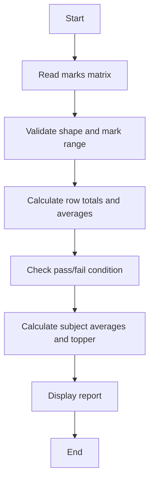

# Case Study 08: Student Marks Matrix Analysis

## 1. Problem Statement
Analyze a matrix of student marks to calculate each student's total and average, subject averages, highest scorer, and pass/fail status.

## 2. Objectives
- Process nested lists
- Compute row and column statistics
- Identify highest total
- Apply pass thresholds

## 3. Assumptions
- Each row represents one student and each column a subject.
- Marks are between 0 and 100.
- A student passes only if every subject mark is at least 35.
- The matrix must be rectangular and non-empty.

## 4. Algorithm
1. Validate matrix dimensions and mark ranges.
2. Calculate each student's total, average, and status.
3. Calculate average marks per subject.
4. Find student with the highest total.
5. Return the analysis.

## 5. Flowchart


## 6. Pseudocode
```text
FUNCTION analyze(marks)\n  VALIDATE non-empty rectangular matrix and marks 0..100\n  FOR each student row: total, average, pass if all marks >= 35\n  FOR each subject column: calculate average\n  FIND row with maximum total\n  RETURN student stats, subject averages, topper\nEND
```

## 7. Python Source Code
See [`../programs/marks_matrix.py`](../programs/marks_matrix.py).

## 8. Test Cases with Solutions
| Test | Input / scenario | Expected solution |
|---|---|---|
| 1. Student totals | [[80,75,90],[45,60,55]] | Totals 245 and 160; topper Student 1 |
| 2. Fail if one subject below 35 | [[70,30,80]] | Student 1 FAIL |
| 3. Perfect marks | [[100,100],[100,100]] | Both PASS; averages 100; topper Student 1 |
| 4. Subject averages | [[80,60],[40,100]] | Subject averages 60.00 and 80.00 |

## 9. Execution Output
Screenshot: `../screenshots/case_08_output.png`.

```text
STUDENT MARKS MATRIX ANALYSIS
Student 1: total=245, average=81.67, PASS
Student 2: total=160, average=53.33, PASS
Student 3: total=270, average=90.00, PASS
Student 4: total=180, average=60.00, FAIL
Subject averages: 71.25, 64.25, 78.25
Topper: Student 3
```

## 10. Test Execution
Automated test file: [`../tests/test_case_08.py`](../tests/test_case_08.py).

```text
test_01_primary (rerun_test_case_08.TestCase08.test_01_primary) ... ok
test_02_boundary (rerun_test_case_08.TestCase08.test_02_boundary) ... ok
test_03_alternate (rerun_test_case_08.TestCase08.test_03_alternate) ... ok
test_04_edge (rerun_test_case_08.TestCase08.test_04_edge) ... ok

----------------------------------------------------------------------
Ran 4 tests in 0.000s

OK

```

## 11. Conclusion
The program implements the specified rules and was checked against the listed test scenarios. Thresholds and rates are illustrative academic assumptions and should be replaced with official requirements if provided by faculty.
