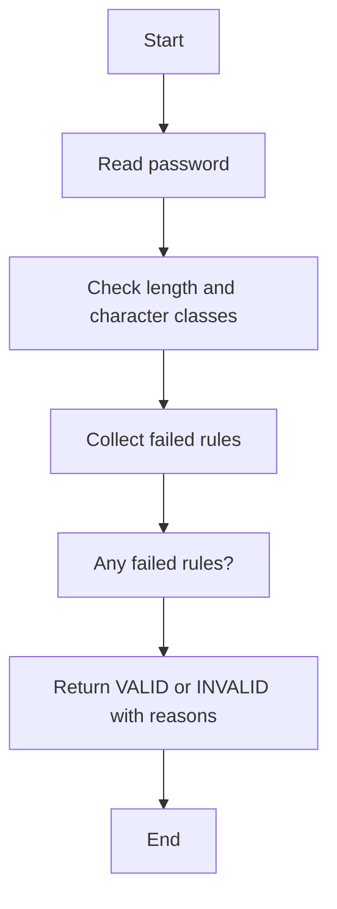

# Case Study 09: Password Policy Validation Engine

## 1. Problem Statement
Validate passwords against a configurable policy including minimum length, uppercase, lowercase, digit, and special-character requirements.

## 2. Objectives
- Inspect strings character by character
- Use Boolean flags and sets
- Report all failed rules at once
- Avoid displaying or storing actual passwords in logs

## 3. Assumptions
- Minimum length is 8 characters.
- Password must contain uppercase, lowercase, digit, and at least one special character from the defined set.
- Whitespace is not accepted.
- This educational validator does not replace secure password storage or authentication.

## 4. Algorithm
1. Check password length.
2. Check for uppercase, lowercase, digit, special character, and whitespace.
3. Collect every failed rule.
4. Return valid status and the failed-rule list.

## 5. Flowchart


## 6. Pseudocode
```text
FUNCTION validate(password)\n  errors = []\n  IF length < 8: add length error\n  IF no uppercase: add uppercase error\n  IF no lowercase: add lowercase error\n  IF no digit: add digit error\n  IF no special char: add special error\n  IF whitespace exists: add whitespace error\n  RETURN valid=(errors empty), errors\nEND
```

## 7. Python Source Code
See [`../programs/password_validator.py`](../programs/password_validator.py).

## 8. Test Cases with Solutions
| Test | Input / scenario | Expected solution |
|---|---|---|
| 1. Valid password | Campus@2026 | VALID; no failed rules |
| 2. Too short | Ab1! | INVALID; length requirement fails |
| 3. Missing special | Campus2026 | INVALID; special character required |
| 4. Whitespace present | Campus @2026 | INVALID; whitespace not allowed |

## 9. Execution Output
Screenshot: `../screenshots/case_09_output.png`.

```text
PASSWORD POLICY VALIDATION ENGINE
Strong sample: VALID
Too short: INVALID
  Rules to fix: minimum length is 8
Missing special: INVALID
  Rules to fix: at least one special character required
Contains space: INVALID
  Rules to fix: whitespace is not allowed
```

## 10. Test Execution
Automated test file: [`../tests/test_case_09.py`](../tests/test_case_09.py).

```text
test_01_primary (rerun_test_case_09.TestCase09.test_01_primary) ... ok
test_02_boundary (rerun_test_case_09.TestCase09.test_02_boundary) ... ok
test_03_alternate (rerun_test_case_09.TestCase09.test_03_alternate) ... ok
test_04_edge (rerun_test_case_09.TestCase09.test_04_edge) ... ok

----------------------------------------------------------------------
Ran 4 tests in 0.000s

OK

```

## 11. Conclusion
The program implements the specified rules and was checked against the listed test scenarios. Thresholds and rates are illustrative academic assumptions and should be replaced with official requirements if provided by faculty.
