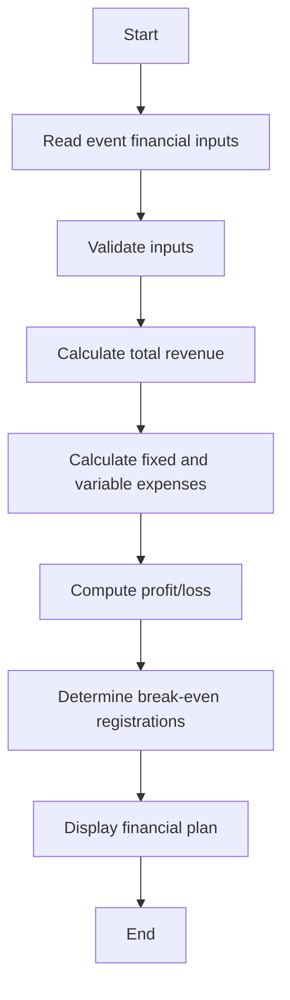

# Case Study 10: Campus Event Financial Planning

## 1. Problem Statement
Estimate revenue, expenses, profit or loss, and break-even attendance for a campus event based on registrations, ticket price, sponsorship, and fixed and per-attendee costs.

## 2. Objectives
- Model event revenue and costs
- Calculate profit or loss
- Estimate break-even attendance
- Support event planning decisions

## 3. Assumptions
- Registration count and costs cannot be negative.
- Revenue = registrations × ticket price + sponsorship.
- Total cost = fixed cost + registrations × variable cost per attendee.
- Break-even is the minimum integer attendance at which ticket revenue plus sponsorship covers costs; if ticket price <= variable cost, it may be impossible without sponsorship.

## 4. Algorithm
1. Validate all inputs.
2. Calculate registration revenue and total revenue.
3. Calculate fixed and variable costs.
4. Calculate profit or loss.
5. Calculate minimum break-even registrations when possible.
6. Return financial summary.

## 5. Flowchart


## 6. Pseudocode
```text
FUNCTION plan_event(n, ticket, sponsor, fixed, variable)\n  VALIDATE all values >= 0\n  revenue = n*ticket + sponsor\n  cost = fixed + n*variable\n  profit = revenue - cost\n  IF ticket > variable: break_even = CEILING((fixed-sponsor)/(ticket-variable)), minimum 0\n  ELSE break_even = 0 if sponsorship covers fixed cost else impossible\n  RETURN summary\nEND
```

## 7. Python Source Code
See [`../programs/event_financial_planning.py`](../programs/event_financial_planning.py).

## 8. Test Cases with Solutions
| Test | Input / scenario | Expected solution |
|---|---|---|
| 1. Profitable event | 300 registrations; ticket ₹200; sponsor ₹30,000; fixed ₹40,000; variable ₹50 | Revenue ₹90,000; cost ₹55,000; profit ₹35,000; break-even 67 |
| 2. Loss event | 50 registrations; ticket ₹100; sponsor ₹0; fixed ₹7,000; variable ₹40 | Revenue ₹5,000; cost ₹9,000; loss ₹4,000; break-even 117 |
| 3. Sponsorship covers fixed cost | 100 registrations; ticket ₹100; sponsor ₹10,000; fixed ₹8,000; variable ₹30 | Revenue ₹20,000; cost ₹11,000; profit ₹9,000; break-even 0 |
| 4. Impossible break-even | 10 registrations; ticket ₹20; sponsor ₹0; fixed ₹1,000; variable ₹25 | Break-even impossible under current ticket price |

## 9. Execution Output
Screenshot: `../screenshots/case_10_output.png`.

```text
CAMPUS EVENT FINANCIAL PLANNING
Tech fest: revenue=₹90000.00, cost=₹55000.00, PROFIT ₹35000.00, break-even registrations=67
Small event: revenue=₹5000.00, cost=₹9000.00, LOSS ₹4000.00, break-even registrations=117
Sponsored event: revenue=₹20000.00, cost=₹11000.00, PROFIT ₹9000.00, break-even registrations=0
```

## 10. Test Execution
Automated test file: [`../tests/test_case_10.py`](../tests/test_case_10.py).

```text
test_01_primary (rerun_test_case_10.TestCase10.test_01_primary) ... ok
test_02_boundary (rerun_test_case_10.TestCase10.test_02_boundary) ... ok
test_03_alternate (rerun_test_case_10.TestCase10.test_03_alternate) ... ok
test_04_edge (rerun_test_case_10.TestCase10.test_04_edge) ... ok

----------------------------------------------------------------------
Ran 4 tests in 0.000s

OK

```

## 11. Conclusion
The program implements the specified rules and was checked against the listed test scenarios. Thresholds and rates are illustrative academic assumptions and should be replaced with official requirements if provided by faculty.
